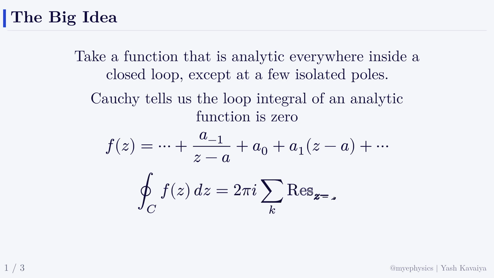
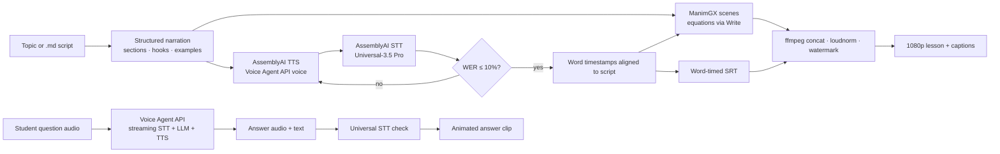
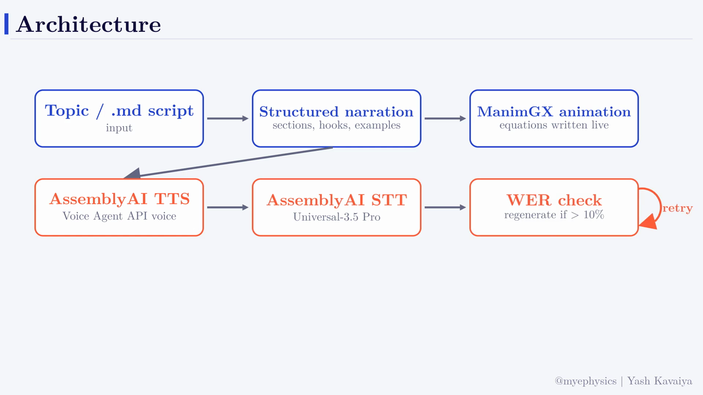
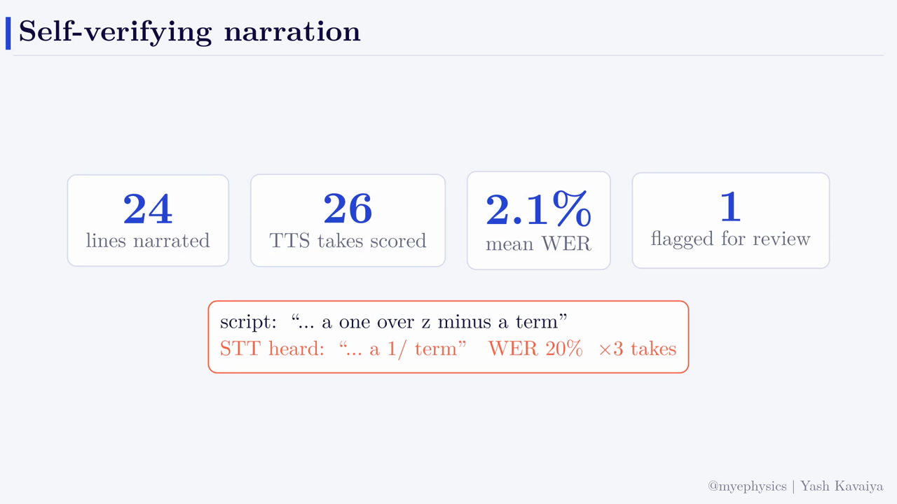
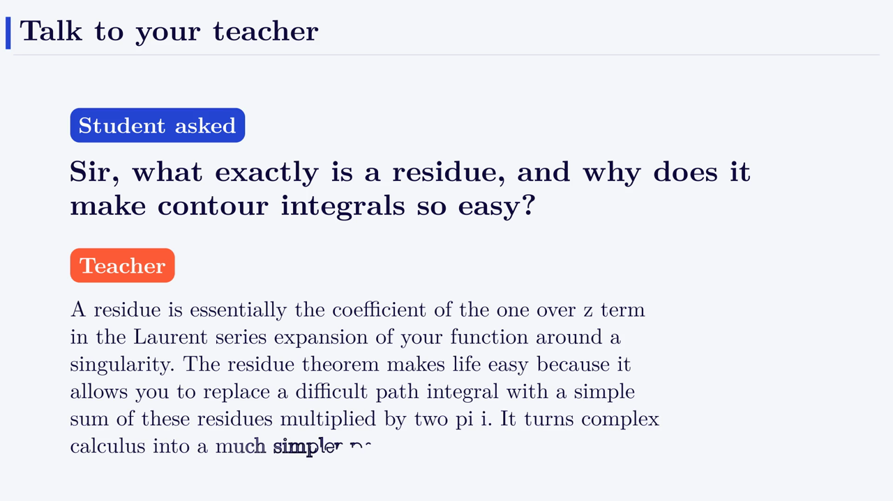

# Mye Physics Voice Studio

**Turn a physics script into a fully animated lesson, narrated with AssemblyAI Text-to-Speech, where every spoken line is checked by AssemblyAI Speech-to-Text before it ships.**

Built for the **AssemblyAI Voice Hackathon: Hack into Speech** (Oct 15–23, 2026) by [Yash Kavaiya](https://github.com/Yash-Kavaiya) for the [Mye Physics](https://www.youtube.com/@myephysics760) channel (B.Sc / M.Sc physics).

🎬 **Demo video:** https://youtu.be/QFNoym-jpbY



## The problem

Making one narrated physics lesson by hand takes hours: write, record, re-record, sync animations, caption. Text-to-speech speeds up the recording, but brings a new risk: **a TTS engine can silently misread a line**, and the mistake reaches thousands of students before anyone notices. Word-timed captions are tedious, so they're usually skipped, which hurts accessibility.

## The solution

Voice Studio is a **self-verifying narration pipeline**:

1. A topic or a `.md` script becomes **structured narration**: sections, mini-hooks, worked examples, an exam-style problem.
2. Each beat becomes **ManimGX animation**: equations are *written* on screen, the layout never overlaps.
3. Each narration line is spoken by **AssemblyAI TTS**.
4. Each take is transcribed straight back by **AssemblyAI Universal STT** and scored with **word error rate (WER)** against the script (math-aware normalisation: `2πi` = "two pi i"). Takes above **10% WER are regenerated automatically**.
5. The STT **word timestamps** are aligned back onto the script, so animations land on the right word and you get **word-timed SRT captions** for free.
6. **ffmpeg** joins the sections, applies **loudnorm** (-16 LUFS) and the `@myephysics | Yash Kavaiya` watermark.

Plus **"Talk to your teacher"**: a student asks a doubt out loud and gets a spoken, animated, captioned answer in seconds.

## Architecture



## AssemblyAI features used

| Feature | Where | How |
|---|---|---|
| **Text-to-Speech** (Voice Agent API voices, e.g. `michael`) | `voicestudio/tts.py` | Inline `session.update` on `wss://agents.assemblyai.com/v1/ws`. The documented `greeting` field is *"sent straight to the TTS engine … word for word"*, so each narration line is synthesised verbatim; 24 kHz PCM16 from `reply.audio`, word timings from `transcript.agent.delta`. |
| **Pre-recorded STT – Universal-3.5 Pro** | `voicestudio/stt.py` | `/v2/upload` + `/v2/transcript` with `speech_models: ["universal-3-5-pro","universal-2"]`, `keyterms_prompt` for physics vocabulary, word-level timestamps. |
| **WER verification loop** | `voicestudio/voice.py` | TTS → STT → WER → regenerate (up to 3 takes), every take logged to `cache/verify_log.jsonl`. |
| **Voice Agent API** (streaming STT + LLM + TTS, turn detection, keyterms) | `voicestudio/teacher.py` | Student audio streamed in real time; the managed agent answers in ≤3 sentences in the teacher's voice. |
| **LLM Gateway** (optional) | `voicestudio/script.py` | `voicestudio lesson --topic "..."` writes the `.md` script. Needs LLM Gateway access on the account. |

> Note: at the time of the hackathon AssemblyAI's docs state TTS is available through the Voice Agent API (a standalone TTS-1 API is on the roadmap). Voice Studio isolates TTS in one module, so swapping to the standalone endpoint is a one-file change.

## Setup

```bash
git clone https://github.com/Yash-Kavaiya/mye-physics-voice-studio
cd mye-physics-voice-studio
python -m venv .venv && . .venv/bin/activate
pip install -r requirements.txt        # websockets, requests, python-dotenv, gradio
pip install manimgx                    # animation engine (+ a LaTeX install and ffmpeg)
cp .env.example .env                   # put your ASSEMBLYAI_API_KEY here (never commit it)
```

System requirements: Python 3.11+, `ffmpeg`, a TeX distribution, and the Latin Modern fonts (`lmodern`).

## Usage

```bash
# .md script -> verified, narrated, captioned lesson
python -m voicestudio.cli lesson examples/residue_theorem.md -o out/residue --name residue_theorem

# one verified line
python -m voicestudio.cli say "The integral equals two pi i times the residue." -o line.wav

# Talk to your teacher (audio file -> spoken answer + animated clip)
python -m voicestudio.cli ask examples/audio/student_question.wav -o out/qa --topic "the residue theorem"

# verification report
python -m voicestudio.cli report

# web UI (mic input)
python -m voicestudio.cli ui
```

### Script format

```markdown
# The Residue Theorem
> One number that solves impossible real integrals
## The Big Idea
? One number decides the integral | What if a whole contour integral depended on just one number?
Each narration line is one spoken beat.
$$ \oint_C f(z)\,dz = 2\pi i\sum_k \operatorname{Res}_{z=a_k} f $$
- bullets appear while the line above is spoken
### Example: A simple pole
Find the residue of one over z squared plus one at z equals i.
```

See [`examples/residue_theorem.md`](examples/residue_theorem.md).

## Screenshots

| Architecture | Self-verification | Talk to your teacher |
|---|---|---|
|  |  |  |

## Results (demo run)

| Metric | Value |
|---|---|
| Narration lines (lesson + demo) | 26 unique lines, 28 TTS takes, 4.3 min of AssemblyAI speech |
| Mean WER (all takes) | 3.2% |
| Takes over 10% WER | 3 (all the same line). After 3 takes it was **flagged for human review** |
| Flagged line | "...a one over z minus a term" came back from STT as "...a 1/ term" |
| Talk to your teacher | first answer audio **1.14 s** after the question ended; answer WER **1.6%** |
| Demo | 4:41, 1080p30, -16 LUFS, built entirely by this pipeline |

## Project layout

```
voicestudio/
  tts.py        AssemblyAI TTS (Voice Agent API greeting -> verbatim speech)
  stt.py        Universal STT + math-aware WER
  voice.py      verify / regenerate / align -> ManimGX Speech with word timings
  script.py     .md -> structured narration; topic -> script (LLM Gateway)
  teacher.py    Talk to your teacher (Voice Agent API)
  assemble.py   render, watermark, concat, loudnorm, SRT merge
  gx/           ManimGX theme + lesson and answer templates
  cli.py, app.py
demo/           the hackathon demo (built with this pipeline)
examples/       sample script + student question
```

## License

MIT © 2026 Yash Kavaiya
